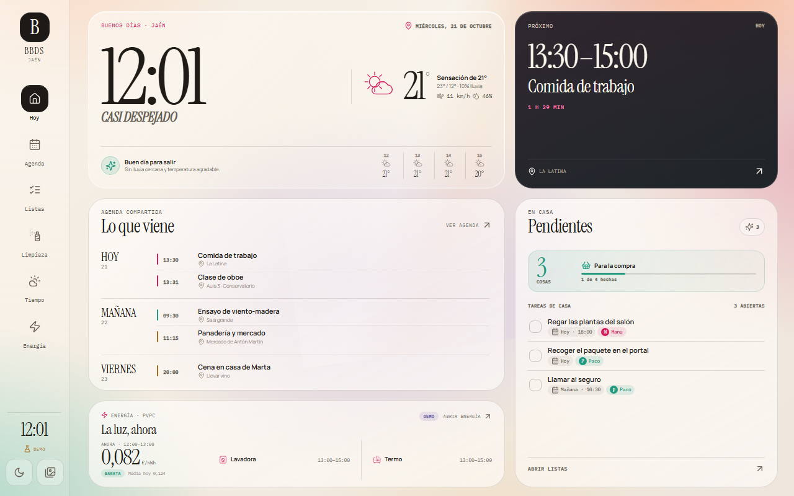
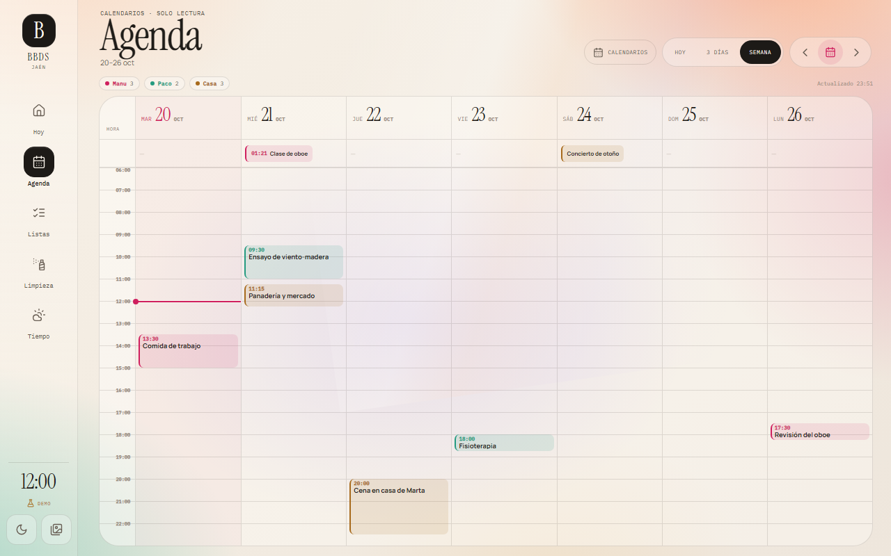
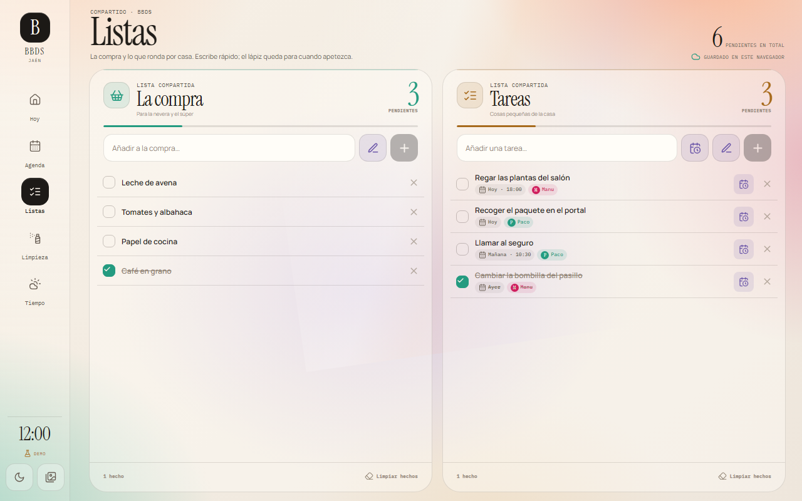
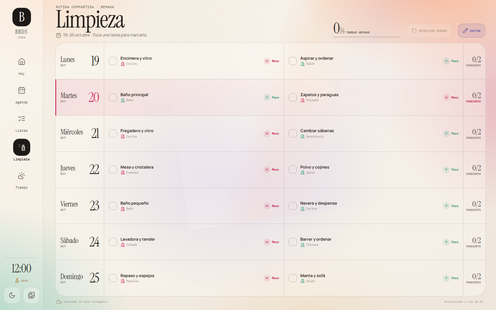
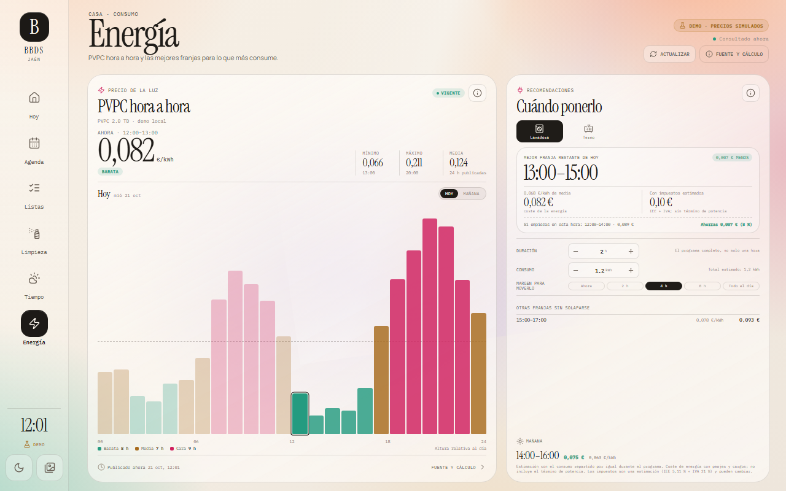
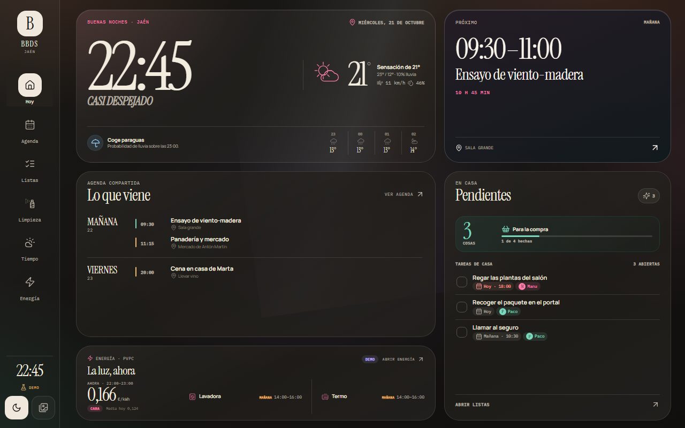
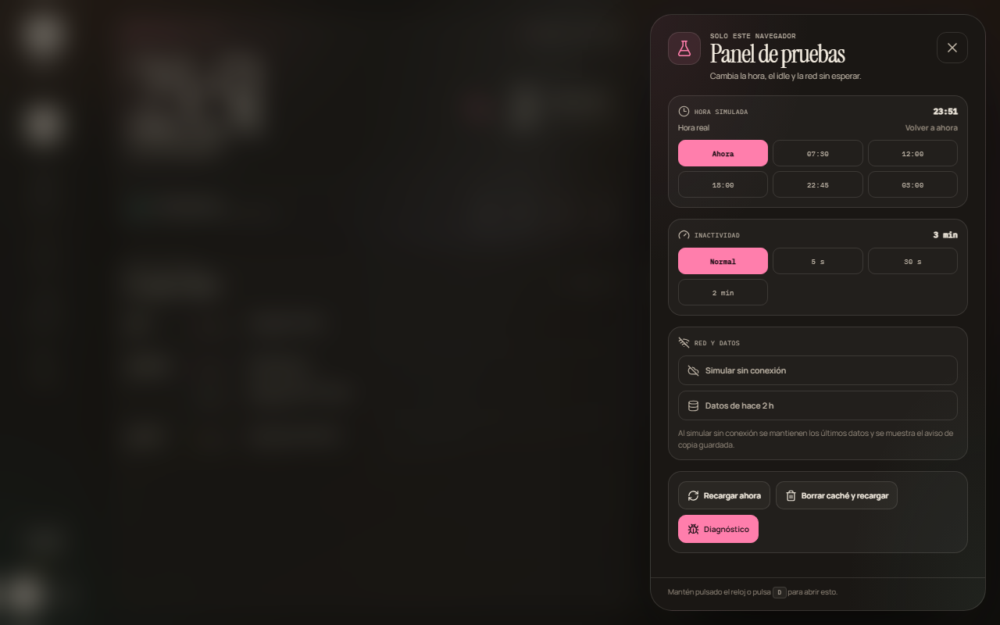
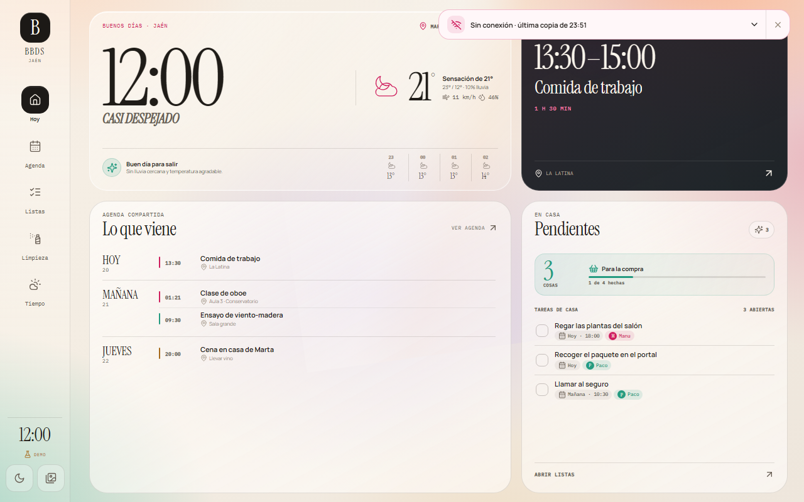
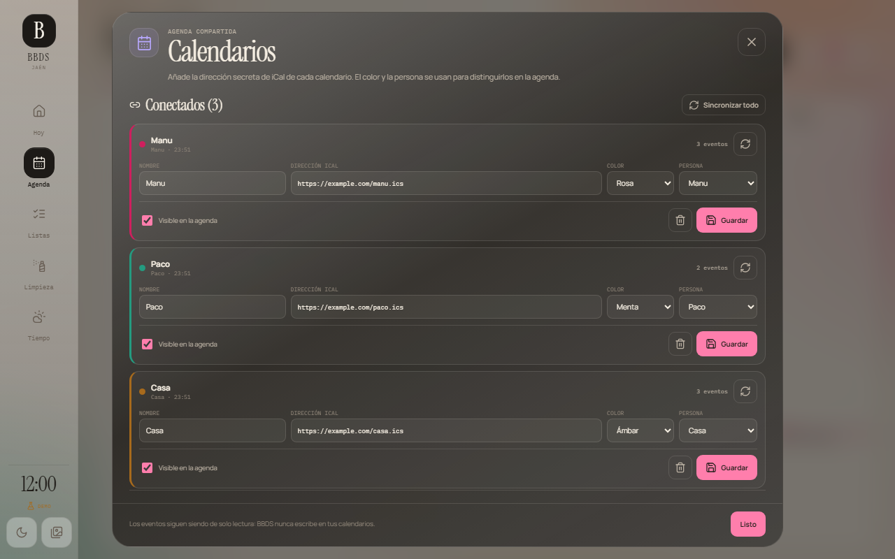
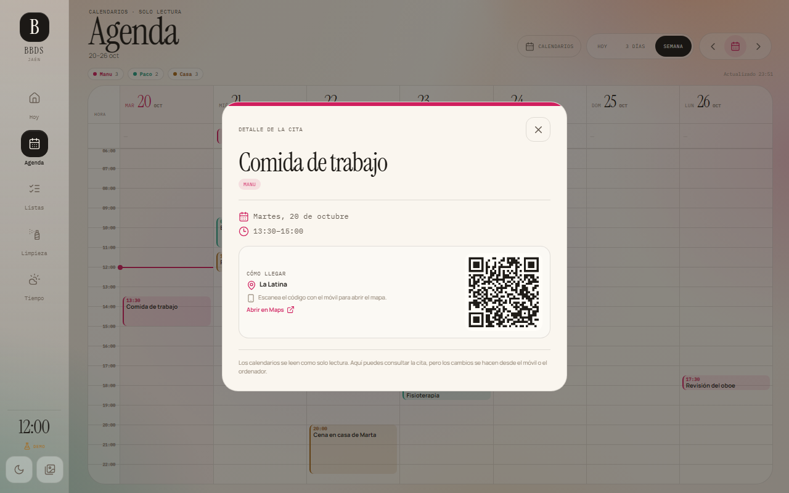

# BBDS

Dashboard doméstico editorial para una pantalla táctil de pared. Papel, tinta y cristal suave: reloj, tiempo exterior con previsión hora a hora, varios calendarios ICS, compra, tareas con fecha y persona, limpieza semanal, clima interior opcional, PVPC y recomendaciones de consumo, fotos de un álbum compartido de iCloud, modo noche y copia sin conexión.

Pensado para **1280 × 800** en horizontal. En pantallas más estrechas el rail y las tarjetas se adaptan, pero esa es la medida de referencia.

## Qué incluye

- **Momento del día**: `.app` lleva `phase-amanecer|dia|tarde|noche` (`dayPhase` en `lib/date.js`). El papel cambia de temperatura (amanecer rosado, tarde ámbar) y cambia el énfasis: por la mañana crece el titular de «Lo siguiente», por la tarde destaca la Compra. Solo colores y tamaños fijos; en modo ligero sin la capa de luz.
- **Saludo** (`lib/greeting.js`): es la voz de la casa (fiestas, clima extremo, rachas, la compra, el día de la semana, la temporada), no un resumen: la agenda, la lluvia y la luz no se repiten ahí porque ya tienen su sitio en «Lo siguiente» y en las baldosas.
- **Buenos días de Yoshi** (`MorningBrief.jsx`): al arrancar o despertar la pantalla entre las 6 y las 12, una vez al día (`bbds.morning.brief`), el día en cuatro líneas: tiempo, primer plan, limpieza y luz.
- **Evolución**: el huevo de cada persona cambia de color con su nivel de la semana (crema → menta → cielo → lila → dorado con brillo) y, con la semana de limpieza completa, Yoshi luce el trofeo en Hoy. Al marcar en Hoy, la tarea lleva un sello de tinta.
- **Agenda**: abre en **Tablero** (siete columnas con lo de cada día, sin rejilla horaria); Hoy, 3 días y Semana siguen disponibles.
- **Listas**: lo hecho se pliega; «Ver N hechos» lo despliega.
- **Salvapantallas**: las fotos se presentan como recuerdo («Tal día como hoy, hace 2 años» / «Hace 2 años · octubre de 2024»).
- **Hoy (diseño)**: arriba la hora, «Lo siguiente» y la ventana de Yoshi, en medio la línea del día —con una marca de **«Ahora»** que separa lo pasado (atenuado) de lo que viene— y la Compra, y abajo **Casa** (`TodayStrip.jsx`) en tres baldosas con número grande: limpieza de hoy y de la semana, puntos y rachas del equipo (abre el resumen) y la luz. Cada dato sale en un solo sitio (la compra lleva su cuenta en su tarjeta; la ciudad, en el rail). Diseño tipo bento: la hora es la baldosa protagonista: crema con el reloj en terracota (de día; de noche Hoy pasa a NightHome); «Lo siguiente» lleva el color macizo del tono de lo que anuncia, y el resto de baldosas, uno según su papel (compra en salvia, limpieza en agua, equipo en lila, luz en mantequilla). Todo color liso, también en el modo ligero, y lo que se lee de lejos no baja de 14–16 px. Como mucho 4 pósits sueltos; el resto queda en un montón «+N notas» que abre la lista. Con el modo noche, Hoy pasa a `NightHome.jsx`: la hora en grande, mañana a primera hora (tiempo, primeros eventos y limpieza) y Yoshi dormido, sin pósits.
- **Hoy**: responde en orden a qué hora y qué tiempo hace (reloj, tiempo actual y próximas horas), qué es **lo siguiente** (una sola tarjeta de color que elige lo más relevante: evento en las próximas 3 h, lluvia, menú, avisos o el próximo evento; la limpieza y la luz van en sus baldosas) y qué pasa hoy en casa: **Hoy y mañana** junta en una lista por horas los eventos, las tareas con fecha (las atrasadas suben a hoy) y la limpieza del día, que se marcan desde ahí. A la derecha, la compra con un campo para añadir y, abajo, las baldosas del equipo (huevo-avatar de cada persona con sus puntos de la semana, nivel y racha; el trofeo abre el resumen semanal) y de la luz; la mejor franja de cada aparato sigue en Energía. La lógica vive en `src/lib/today.js`. Inicio no muestra clima interior.
- **Agenda**: varios calendarios ICS de solo lectura con vistas **Hoy**, **3 días** y **Semana**. Cada feed tiene nombre, persona y color; se añaden, pausan o borran desde **Calendarios**, sin tocar código. Los eventos fuera de la rejilla 06:00–23:00 aparecen como fichas con hora en la fila de todo el día. La ficha de un evento incluye un QR con su ubicación.
- **Listas**: compra y tareas con contadores grandes, progreso y entrada rápida siempre visible. Las tareas admiten fecha, hora y persona, muestran su estado con etiquetas y se ordenan por vencimiento; se pueden programar en línea sin salir de la lista. El texto es el flujo principal; la libreta manuscrita con OCR local queda como acción secundaria.
- **Limpieza**: cuadrante semanal de Manu y Paco con dos tareas por día, zona y persona asignadas. El cuadrante y las personas viven en D1 y se editan desde la propia pantalla; cada check se guarda por semana y **Reiniciar semana** vuelve a dejar el tablero limpio.
- **Tiempo**: temperatura exterior, sensación térmica, icono del cielo, humedad, viento, lluvia, UV, salida y puesta de sol, previsión de siete días y panel **Próximas horas** (temperatura y probabilidad de lluvia de las 12 horas siguientes, con aviso de cuándo empieza a llover).
- **Energía**: PVPC 2.0 TD hora a hora, precio vigente, mínimo, máximo y media del día, bandas barata/media/cara, gráfico de 24 h con horas pasadas atenuadas y pestañas **Hoy**/**Mañana**. La tarjeta de recomendaciones calcula la mejor franja completa para la lavadora o el termo eléctrico, con duración, consumo y margen configurables; compara con empezar lo antes posible y muestra el ahorro estimado en euros y porcentaje. Incluye fuente, vigencia, impuestos estimados y método de cálculo en una hoja de detalle.
- **Casa**: temperatura y humedad por habitación, histórico de 24 h y 7 días, tendencia, riesgo de moho, batería/presión del sensor y consejos de ventilación. Solo aparece con `VITE_CLIMATE_ENABLED=true`.
- **Fotos**: salvapantallas con las fotos de un álbum compartido de iCloud, tras unos minutos sin actividad o desde el botón del rail. De noche solo muestra la hora, tenue. Se vuelve tocando la pantalla, con `Esc` o con las flechas.
- **Modo noche**: variante de tinta oscura del mismo diseño, automática por horario y con atenuación manual temporal.
- **Sin conexión y frescura**: un service worker guarda el shell y la última respuesta buena de tiempo, listas, limpieza, agenda y energía. Si una fuente falla, el dashboard sigue mostrando la copia anterior y un aviso indica cuándo se actualizó por última vez. La vista **Energía** conserva además su propia copia en `localStorage` y marca como «sin confirmar» cualquier dato que no cubra la hora actual. La recarga nocturna y la vuelta a **Hoy** tras inactividad mantienen el kiosco fresco.
- **Panel de pruebas y diagnóstico**: en modo demo, `D`, pulsación larga en el reloj del rail o `?demo` abren hora simulada, idle, red, datos antiguos y accesos rápidos. En producción esos gestos abren el diagnóstico. `Shift+I` o `?diag` muestran estado de red, service worker, cachés, almacenamiento y compatibilidad del WebView.
- **Deep links**: `#home`, `#agenda`, `#lists`, `#cleaning`, `#weather`, `#energy` y, con clima activado, `#climate`.
- **Demo navegable** sin backend (`npm run dev:demo`), con listas, limpieza, calendarios y precios PVPC simulados que se identifican como demo.

## Capturas

Todas están tomadas a 1280 × 800. La carpeta completa está en [`docs/screenshots/`](docs/screenshots/) y la galería navegable en [`docs/screenshots/index.html`](docs/screenshots/index.html).

| Hoy | Agenda semanal |
| --- | --- |
|  |  |

| Listas y tareas | Limpieza |
| --- | --- |
|  |  |

| Energía | Modo noche |
| --- | --- |
|  |  |

| Panel de pruebas | Sin conexión |
| --- | --- |
|  |  |

| Calendarios | Detalle con QR |
| --- | --- |
|  |  |

## Arranque rápido

Requisitos: Node 22.12 o superior y npm.

```bash
npm install
npm run dev:demo
```

Abre `http://127.0.0.1:5173`. En modo demo los datos son de ejemplo: las listas y la limpieza se guardan en local, el tiempo se genera localmente y la energía usa precios PVPC ficticios claramente marcados. El calendario y los sensores no necesitan Worker. El tiempo de demo no hace peticiones a Open-Meteo, y y las fotos del salvapantallas son de ejemplo y van empaquetadas.

### Tu calendario real en la demo

La demo también puede leer feeds ICS reales, sin Worker ni D1:

1. Arranca `npm run dev:demo`.
2. Abre **Agenda → Calendarios** y añade el nombre y la dirección secreta del calendario (`.ics` o `webcal://`).
3. Pulsa **Añadir** y luego **Sincronizar todo** si quieres forzar la lectura.

Los calendarios que añadas se guardan en `localStorage` (`bbds.demo.calendars.v1`) y siguen ahí al recargar. Mientras haya un feed real, la demo lo descarga a través de un proxy local de Vite (`/api/ics`) para evitar el bloqueo CORS de iCloud y Google. Ese proxy solo existe con `npm run dev:demo`; si abres un build estático de la demo, el feed real mostrará un aviso y seguirás viendo los calendarios de ejemplo.

La demo sigue siendo de solo lectura y no escribe nunca en tu calendario. Para la app desplegada usa el Worker y D1, como se explica más abajo.

### Demo con datos reales del Worker

Necesitas dos terminales:

```bash
# Terminal 1: Worker + D1 local + assets de dist
npm run db:migrate:local
npm run build
npm run api

# Terminal 2: Vite y proxy /api -> 127.0.0.1:8787
npm run dev
```

El frontend de desarrollo estará en `http://127.0.0.1:5173` y la API en `http://127.0.0.1:8787/api`.

> `wrangler dev` sirve los assets de `dist`, por eso hay que compilar antes de arrancarlo. Si solo estás tocando React, el build no es necesario para el HMR; el Worker y Vite son procesos independientes.

## Escribir listas con el dedo

En **Listas**, cada tarjeta tiene un botón de lápiz junto al campo de texto.

1. Toca el lápiz.
2. Escribe una línea con el dedo, un lápiz o el ratón. Puedes cambiar el color de tinta, deshacer o borrar.
3. Pulsa **Reconocer texto**. La primera vez se descarga el modelo (unos 70 MB); después queda en la caché del navegador y no vuelve a descargarse.
4. Revisa el texto detectado, corrige tildes, ñ o palabras, y pulsa **Añadir a la lista**.

El reconocimiento se ejecuta en el propio dispositivo con [Transformers.js](https://huggingface.co/docs/transformers.js) y el modelo `Xenova/trocr-small-handwritten`. La imagen de la libreta no se envía a ningún servidor. Los binarios de ONNX Runtime se sirven desde `public/ort/` para no depender de un CDN adicional.

El modelo está entrenado con texto manuscrito en inglés (IAM), así que **es una ayuda, no una transcripción perfecta**: puede omitir tildes o la ñ y confundir palabras cortas. Por eso el texto siempre aparece en una caja editable antes de guardarse. Si la descarga o la inferencia fallan, la caja sigue disponible para escribir el texto a mano; se guarda como texto real y no como imagen. Para mejorar el resultado, escribe una sola línea y separa ligeramente las palabras.

Las notas nuevas se guardan como texto (`text`) y funcionan como cualquier otro elemento de la lista. El campo `drawing` se conserva para las notas antiguas creadas antes de este cambio: se siguen mostrando como imagen y se pueden borrar o marcar como hechas. La libreta usa Canvas y Pointer Events (dedo, stylus y ratón).

## Tareas con fecha, hora y persona

Las tareas de la lista `tasks` aceptan tres metadatos opcionales: `dueOn` (`YYYY-MM-DD`), `dueAt` (`HH:MM`) y `personId` (`manu` o `paco`). Se editan en línea tocando la etiqueta de la tarea: el editor permite cambiar fecha, hora y persona, quitar los metadatos o guardar y cerrar. En la lista se muestran como etiquetas (`Hoy`, `Mañana`, `20/10`, `18:00`) y las tareas pendientes se ordenan por vencimiento.

La migración `0004_todos.sql` añade las tres columnas a `list_items`; no hay una tabla nueva. En la API, `POST /api/lists` y `PATCH /api/lists/:id` aceptan `dueOn`, `dueAt` y `personId`; la respuesta devuelve `dueOn`, `dueAt` y un objeto `person` con nombre, tono e iniciales. Solo las tareas usan estos campos; la compra mantiene el flujo simple.

## Limpieza semanal

El cuadrante está pensado para Manu y Paco: catorce tareas fijas, dos por día, repartidas entre personas y zonas. En producción vive en D1 (`people`, `cleaning_tasks` y `cleaning_checks`); la migración `0003_people_cleaning.sql` crea las dos personas y el cuadrante inicial. Cada check se guarda con la clave del lunes de esa semana, así que el tablero arranca limpio al cambiar de semana sin necesidad de un cron.

El botón **Editar** abre el editor de la pantalla: permite cambiar título, zona, persona y día, añadir tareas o borrar las que ya no sirvan. Los cambios se guardan en D1 y se ven en todos los dispositivos. **Reiniciar semana** desmarca los checks de la semana actual; no borra las tareas.

En demo, las personas, las tareas y los checks se guardan en `localStorage` (`bbds.demo.cleaning.v1`). Los ids de las tareas deben permanecer estables: son la clave con la que se conservan los checks.

Rutas principales: `GET /api/cleaning?week=YYYY-MM-DD`, `PATCH /api/cleaning/checks`, `POST /api/cleaning/reset` y el CRUD de `/api/cleaning/tasks`.

### Puntos, rachas y resumen semanal

Los puntos se calculan en el cliente (`src/lib/points.js`) y se reinician el lunes: 10 por tarea de limpieza hecha, 5 por cada tarea de la lista con dueño marcada esta semana, +20 a quien termina todo lo suyo y +10 a cada uno si la casa completa la semana. Los niveles van de «Huevo» a «Leyenda de casa». La racha personal sale de `personStreaks` del Worker más la semana en curso si ya está completa. El **resumen semanal** (`WeeklySummary.jsx`) se abre solo el domingo desde las 20:00, una vez por semana (`localStorage` `bbds.summary.seen`), y siempre desde el trofeo de Hoy. Es una hoja `ink-sheet` como Energía o Calendarios: Yoshi (con el trofeo si hay ganador) en la cabecera, una columna por persona con puntos, nivel, limpieza, tareas y racha, un título para cada uno («Todo hecho», «En racha», «Modo sofá»…), la casa y la semana que viene.

## Notas en Hoy

Las notas viven sueltas sobre la pantalla de Hoy, como pósits en la nevera (`HomeNotes.jsx`). Se arrastran a cualquier sitio, se estiran desde la esquina y, al tocarlas, sale una barra para cambiar el color, la forma (pósit, redonda, nube, rayada, etiqueta), el tamaño y el giro, o quitarlas con «Visto». Solo los pósits capturan el dedo: el panel de debajo sigue funcionando. Durante el arrastre solo se toca el `transform` del elemento; la posición (fracción de la vista) se guarda al soltar con `PATCH /api/notes/:id` (migración `0007_note_layout.sql`). El botón **Nota** de la tarjeta de Compra abre la hoja para escribir una nueva. El texto se ajusta al tamaño del pósit.

## Yoshi

La mascota vive en **su ventana** (`YoshiWindow.jsx`), arriba a la derecha de Hoy, como un Tamagotchi en la pared: por la ventana se ve el cielo de verdad según la hora (amanecer, día, tarde, noche con luna y estrellas) y el tiempo (nubes, lluvia, nieve), y debajo su estado («Viendo llover», «Con hambre»…). Todo son fondos fijos. Fuera de Hoy no se monta ni gasta; de noche se muda al Hoy nocturno. Son 16 sprites WebP de 192 px con alfa en `src/assets/yoshi/` (unos 130 KB en total), al estilo de *Yoshi's Island* con borde de pegatina, todos mirando a la derecha y con los pies a la misma altura; las animaciones son solo CSS (`transform`/`opacity`). Salen de una hoja 4×4 con fondo magenta, en este orden: idle, blink, happy, run / sleep, rain, cold, hot / hungry, cheer, trophy, halloween / navidad, cumple, stretch, dizzy. Para regenerarlos: `node scripts/yoshi-sprites.cjs <hoja> src/assets/yoshi sharp` (`sharp` llega como dependencia transitiva); el script quita el magenta, los números y la rejilla, y limpia el rosa de los bordes.

- **Estado**: duerme de noche y en modo noche, paraguas si llueve, bufanda con 10 °C o menos, abanicos con 31 °C o más y manzanas a la hora de comer (13–15 h) y cenar (20–22 h). Disfraz en Halloween, Navidad y cumpleaños.
- **Vida propia**: respira, parpadea cada pocos segundos y cada 12–25 s hace algo solo: un saltito, darse la vuelta, bostezar o decir algo. Dormido, ronca.
- **Toques**: uno, salta y habla; 3 seguidos, se marea; 5, se enfada; 7, se va de paseo. Mantener pulsado le da mimos (corazones). Dormido, se despierta un momento y protesta.
- **Sabe lo que pasa en casa** (`src/lib/yoshiTalk.js`): al tocarlo o cuando habla solo, comenta la limpieza pendiente de hoy («¡Ánimo, Manu! Hoy te toca baño principal.»), el próximo evento de las 3 h siguientes («En 40 min: clase de oboe, Paco.»), lo que falta en la compra y los cumpleaños («¡Mañana es el cumple de Paco! 🎂» / «¡Feliz cumple, Paco!»). La primera vez que se le toca por la mañana da los **buenos días**, y se alegra con cada **nota nueva** (aviso `bbds:yoshi` en `window`).
- **Manzanas** (tipo Tamagotchi): cada tarea hecha (limpieza o lista de tareas) es una manzana que se come al momento; el contador del día sale bajo Yoshi y se reinicia a medianoche (`localStorage` `bbds.yoshi.apples`, con qué tarea dio cada manzana). Si la tarea se desmarca, Yoshi devuelve su manzana (también al cargar, si se desmarcó con la pantalla apagada); marcarla otra vez no da una segunda, y borrar una tarea hecha no quita la suya. Sin ninguna pasado el mediodía tiene **hambre** y lo dice; con 5 o más, está lleno y contento. La primera carga de datos no cuenta como tarea hecha.
- **Saluda** al volver del salvapantallas o de un paseo.
- **Paseos**: de día, cada 25–45 min sale de la barra y cruza la pantalla corriendo por abajo (`YoshiStroll`); mientras, en la barra quedan unas huellas 🐾 y «De paseo…».
- También aparece, con el trofeo, en el resumen semanal.

Es fan art de uso privado: Yoshi es un personaje de Nintendo; no publiques los sprites en un repositorio público.

## Tiempo y fotos

`WeatherView` compone las condiciones actuales, la previsión de siete días y `HourlyPanel` (las próximas 12 horas de Open-Meteo). Open-Meteo devuelve las horas en `VITE_TIMEZONE` sin desfase; `src/lib/weather.js` las compara como texto para no depender de la zona horaria del aparato.

El salvapantallas lee un **álbum compartido de iCloud** con «Sitio web público» activado (enlaces nuevos `https://photos.icloud.com/shared/album/…`, que se leen por CloudKit con acceso anónimo, o los antiguos `https://www.icloud.com/sharedalbum/#…`; los de invitación, que piden un correo, no se pueden leer).

La decoración de temporada (hojas en otoño, murciélagos y calabazas en Halloween, luces en Navidad…) es una composición fija por temporada en `COMPOSITIONS` de `src/components/SeasonDecor.jsx`, dibujada con las pegatinas de `src/assets/pegatinas/` (24 dibujos estilo Yoshi's Island de una hoja de Gemini, recortados a WebP con transparencia, 2–7 KB cada uno; las mismas salen en el rail, en la ventana de Yoshi y junto a los títulos; lo que no tiene pegatina, como el confeti o las chispas, sigue en SVG): unas pocas piezas colocadas a mano en el marco (la columna entre el rail y las tarjetas, el margen derecho y las esquinas), algunas colgando de un hilo, y guirnalda arriba en Navidad, feria y cumpleaños. Va por debajo de las tarjetas, así que nunca tapa datos. La decoración y el saludo de Hoy salen de `src/lib/season.js` y `src/lib/greeting.js`. También marca las fiestas de casa: San Antón, la Capilla y San Lucas en Jaén, Semana Santa, la feria de Torreperogil (Paco) y San Miguel en Úbeda (Manu), y los cumpleaños que se guardan en Limpieza → Editar. Las fechas de las ferias son aproximadas y fijas en el código. Para ver una temporada sin esperar a su fecha: `?temporada=navidad` (también `otono`, `spooky`, `halloween`, `invierno`, `amor`, `primavera`, `verano`, `feria`, `lumbres`, `semanasanta`, `cumple`); añade `&fiesta` para verla como día señalado.

La intensidad sube hasta el día. El resto de la temporada solo hay detalles: el marco, el dibujo del rail, la marca de las tarjetas y la ventana de Yoshi, que cambia lo que se ve fuera (murciélagos, hojas, un abeto, flores…) y lo que hay en el alféizar. El día señalado (cualquier temporada con nombre: Halloween, Nochebuena, la feria, San Antón, un cumpleaños…) la app lleva la clase `is-fiesta` y la casa entera se viste: fondo de color liso detrás de las tarjetas (lila en Halloween, verde abeto claro en Navidad, albero en la feria…, también en el modo ligero), la escena completa en la ventana (anochecer con luna en Halloween, nieve en Navidad, lumbres en San Antón), el saludo es la propia fiesta («Feliz Halloween.») y desaparece la cuenta atrás.

El cristal de la ventana de Yoshi usa las ilustraciones de `src/assets/ventana/` (estilo Yoshi's Island, generadas con Gemini en hojas de paneles y cortadas a WebP de 5–12 KB). Por orden: `<temporada>-fiesta.webp` el día señalado, `<temporada>.webp` toda la temporada (hoy solo `feria.webp`) y, el resto del año, `diario-<momento>-<cielo>.webp`: la misma vista de olivos y pueblo blanco en `amanecer`, `dia`, `tarde` o `noche` y con cielo `clear`, `cloud`, `rain` o `snow`, según la hora y el tiempo de Open-Meteo, con los detalles de temporada dibujados encima. Si falta la que toca, queda la escena dibujada en CSS y SVG. El cristal mide 156 × 188 px en pantalla: los paneles se recortan a cubrir, algo más por abajo que por arriba, y Yoshi tapa el centro de abajo, así que lo importante tiene que ir en el cielo y a los lados. «Lo siguiente» en Hoy añade avisos de calendario (cambio de hora, radiadores, filtros, uvas), cumpleaños cercanos y el ganador de la limpieza del mes. De noche, el salvapantallas enseña la fase de la luna, la mínima y lo primero de la agenda. El enlace se elige desde el propio salvapantallas (botón del engranaje) y se guarda en D1 (`app_meta`); `ICLOUD_ALBUM_URL` sirve de respaldo. El Worker lee el álbum, elige la versión de cada foto más pequeña que cubre 1280 px y la sirve desde `/api/photos/:id` con caché, porque las URLs de Apple caducan. Lo más cómodo es pegar el enlace abriendo BBDS en el móvil o el PC: la pantalla lo recoge sola. En demo se usan las fotos de `src/assets/gallery/`.

## Energía, PVPC y recomendaciones

La vista **Energía** (`#energy`) trabaja solo con **PVPC 2.0 TD (Península)**, el precio regulado de un hogar acogido al mercado regulado. No mezcla ese precio con el mercado mayorista ni con una tarifa libre: el precio de la energía incluye peajes y cargos, pero **no incluye IEE ni IVA**. La hoja **Fuente y cálculo** detalla la fuente, la hora de publicación, la consulta, los días disponibles y las limitaciones.

Los precios se piden al Worker en `GET /api/electricity`. El Worker intenta primero la serie PVPC `1001` de REE (`apidatos`) y, si falla, recurre a ESIOS (`indicators/1001`, Península). Guarda la respuesta 10 minutos en memoria, devuelve `stale: true` con el último dato si las dos fuentes fallan y evita mezclar series. El cliente refresca cada 30 minutos, al volver a la pestaña y al recuperar conexión; conserva una copia en `localStorage` (`bbds.electricity.v1`) y no presenta una copia antigua como si cubriera la hora actual.

La tarjeta de recomendaciones:

- Trabaja con horas enteras y consecutivas, en `Europe/Madrid`. Un día de cambio de hora puede tener 23 o 25 horas y la etiqueta de la franja añade la duración real cuando el reloj de pared no coincide.
- Exige que la franja cubra **todo el programa** (duración configurada) y no propone huecos incompletos.
- Si el programa empieza en la hora actual, solo lo permite cuando quedan al menos 30 minutos; cuenta esa hora completa a su precio y no prorratea minutos.
- Ordena las opciones por coste y elimina las que se solapan. La referencia «lo antes posible» usa la primera franja viable para calcular el ahorro.
- Reparte el consumo por igual entre las horas del programa porque no hay un perfil real de potencia. Es una estimación, no una lectura del contador.
- Estima IEE (5,11 %) e IVA (21 %) solo sobre el término de energía cuando la fuente es PVPC. No incluye término de potencia, alquiler del contador ni otros cargos fijos. La factura real puede diferir.

Configuración disponible por electrodoméstico: duración, consumo total (o por hora en el termo) y margen para mover la franja (ahora, 2 h, 4 h, 8 h o todo el día). Se guarda en `localStorage` (`bbds.energy.settings.v1`) y la tarjeta de Inicio reutiliza esa misma configuración. Si hoy ya no cabe un programa completo, el resumen de Inicio muestra la mejor franja de mañana marcada como **mañana**. En demo, `src/lib/demo.js` genera precios ficticios con la etiqueta **Demo**; nunca se muestran como precios reales.

## Sin conexión, frescura y diagnóstico

En producción, `public/sw.js` guarda el shell de la app y la última respuesta buena de las rutas same-origin (`/api/...`) y de Open-Meteo. Las peticiones usan red primero y, si fallan, caen a la copia guardada. El service worker solo se registra en el build de producción, no en `npm run dev`; para probarlo hay que servir `dist` con `npm run preview` desde `localhost` o HTTPS.

La franja de estado global resume la frescura de cuatro fuentes: tiempo, listas, limpieza y agenda. **Energía** mantiene su propio aviso de vigencia y copia local tanto en Inicio como en su vista, porque el precio se consulta al arrancar y se refresca cada 30 minutos. Si una fuente falla, se sigue viendo el último dato y el aviso explica cuándo se actualizó. **Estado** abre el detalle por fuente; cada tarjeta de la agenda también puede mostrar su propio error de feed sin tumbar los demás.

En modo demo, el panel de pruebas (`D`, pulsación larga en el reloj del rail o `?demo`) permite simular **sin conexión**, forzar **datos de hace 2 h**, cambiar la hora y el idle o abrir el diagnóstico. El diagnóstico (`Shift+I` o `?diag`) muestra red, visibilidad, service worker, cachés, almacenamiento y una comprobación de APIs/CSS del WebView; el botón **Copiar diagnóstico** genera un JSON para pegar en un informe.

`npm run check:webview` revisa el build contra el objetivo Chrome 64 de `vite.config.js` y avisa de sintaxis o CSS que puedan degradarse en un WebView antiguo. Los avisos del chunk opcional de OCR y de `color-mix()`, `dvh`, `backdrop-filter` o flex `gap` son esperados: la app funciona y el efecto visual se degrada en navegadores muy antiguos. `npm run check:energy` comprueba sin red los cálculos de PVPC: formatos, franjas completas, huecos, ahorro, impuestos, días de 23/25 horas y los parseadores de REE y ESIOS.

## Configuración del frontend

Copia `.env.example` a `.env.local` (o crea las variables en el entorno de build):

```env
VITE_DEMO_MODE=false
VITE_API_BASE=
VITE_DASHBOARD_TOKEN=
VITE_LOCATION_NAME=Jaén
VITE_LATITUDE=37.7796
VITE_LONGITUDE=-3.7849
VITE_TIMEZONE=Europe/Madrid
VITE_NIGHT_START=22:30
VITE_NIGHT_END=07:30
VITE_CALENDAR_DAYS=21
VITE_CLIMATE_ENABLED=false
VITE_SCREENSAVER_IDLE_MINUTES=3
VITE_NIGHTLY_RELOAD_HOUR=3
VITE_IDLE_RETURN_MINUTES=10
```

- `VITE_DEMO_MODE=false` es lo normal para producción. `npm run dev:demo` carga `.env.demo` con `true`.
- `VITE_API_BASE` se puede dejar vacío porque frontend y Worker comparten dominio. Vite redirige `/api` en desarrollo.
- `VITE_DASHBOARD_TOKEN` solo es necesario si activas `DASHBOARD_TOKEN` en el Worker. Es un token de cliente: acaba en el bundle, así que no lo consideres seguridad fuerte.
- `VITE_CLIMATE_ENABLED=false` (valor por defecto) oculta **Casa**, su deep link `#climate` y detiene las llamadas a `/api/sensors`. Inicio no muestra ninguna tarjeta de clima. Cuando lleguen los sensores, ponlo en `true`, vuelve a compilar y despliega. Los sensores y el simulador pueden seguir existiendo en el Worker mientras la interfaz está oculta.
- `VITE_MENU_ENABLED=false` (valor por defecto) oculta el menú semanal: el botón **Menú** de Listas y el plato del día en Hoy, con su botón para pasar los ingredientes a la compra. El Worker ya tiene `GET`/`PUT /api/menu` (`{ days: [{ dish, ingredients[] }] }`, lunes = 0, guardado en `app_meta`).
- `VITE_CALENDAR_DAYS=21` controla la ventana de agenda que se pide al Worker.
- `VITE_SCREENSAVER_IDLE_MINUTES=3` son los minutos sin actividad antes de abrir la galería. Usa `0` para desactivar la apertura automática; el botón de galería del rail seguirá funcionando.
- `VITE_NIGHTLY_RELOAD_HOUR=3` fija la recarga diaria del kiosco. En demo no se programa. Sirve para que el WebView no acumule memoria durante semanas.
- `VITE_IDLE_RETURN_MINUTES=10` devuelve la pantalla a **Hoy** tras ese tiempo sin interacción. Usa `0` para desactivarlo. Es independiente del salvapantallas: a los 3 minutos se abren las fotos y a los 10 la vista de fondo vuelve a **Hoy**.
- El tiempo se pide a Open-Meteo desde el navegador, con caché de 24 h en `localStorage`. Las fotos del salvapantallas se piden al Worker solo mientras está abierto.

## Worker y D1

### Secretos locales

Copia `.dev.vars.example` a `.dev.vars`:

```env
SENSOR_TOKEN=dev-sensor-token
DASHBOARD_TOKEN=
ESIOS_TOKEN=
ICLOUD_ICS_URL=
ICLOUD_ALBUM_URL=
```

`.dev.vars` está ignorado por Git. `ESIOS_TOKEN` es opcional: REE es la fuente principal y ESIOS el respaldo, pero una clave de ESIOS evita límites de uso y permite consultas filtradas si algún día hacen falta.

### Calendarios ICS

Los calendarios se gestionan desde **Agenda → Calendarios**: nombre, persona, color y URL. En producción viven en la tabla `calendars` de D1 (`0005_calendars.sql`); en demo se guardan en `localStorage` (`bbds.demo.calendars.v1`). Se pueden añadir varios feeds, pausar uno sin borrarlo y sincronizar todo cuando haga falta.

La URL debe ser la dirección secreta del calendario en formato iCal (`.ics` o `webcal://`), no la página pública de Google Calendar. El Worker convierte `webcal://` a `https://`, rechaza enlaces públicos de Google, hosts locales/privados y URLs duplicadas. Si un feed falla, los demás siguen funcionando y la agenda conserva la última copia buena de cada uno.

`ICLOUD_ICS_URL` sigue siendo opcional para instalaciones antiguas: si existe y la tabla de calendarios está vacía, el Worker la siembra una vez como calendario **Casa**. Después se gestiona como cualquier otro feed y no reaparece si se borra.

La agenda es de solo lectura. El dashboard abre la ficha de una cita para consultar fecha, hora, lugar y QR de ubicación; cualquier cambio se hace desde el dispositivo donde está el calendario original.

### Simulador de sensores

Con el Worker local arrancado:

```powershell
$env:SENSOR_TOKEN="dev-sensor-token"
npm run sensors:simulate -- --once
```

En macOS/Linux:

```bash
SENSOR_TOKEN=dev-sensor-token npm run sensors:simulate -- --once
```

Sin `--once` envía una lectura de `salon` y `dormitorio` cada 60 segundos. Variables útiles:

| Variable | Por defecto | Uso |
| --- | --- | --- |
| `WORKER_URL` | `http://127.0.0.1:8787` | URL del Worker |
| `SENSOR_IDS` | `salon,dormitorio` | ids separados por coma |
| `SENSOR_TOKEN` | vacío | mismo valor que el Worker |
| `INTERVAL_MS` | `60000` | intervalo entre lecturas |

El payload que debe enviar un ESP32 es:

```json
{
  "room": "salon",
  "temperature": 21.4,
  "humidity": 47.8,
  "pressure": 1012.6,
  "battery": 88.2
}
```

Cabecera obligatoria si existe `SENSOR_TOKEN`:

```http
X-Sensor-Token: dev-sensor-token
```

`pressure`, `battery` y `recordedAt` son opcionales. `recordedAt` debe ser una fecha ISO; si no se envía, el Worker usa la hora de recepción. Cada sensor debe hacer POST a `/api/sensors` aproximadamente cada minuto. El histórico se guarda desde la primera lectura.

## API

| Método | Ruta | Descripción |
| --- | --- | --- |
| `GET` | `/api/health` | Estado y si calendarios, tokens, limpieza, personas y energía están disponibles. |
| `GET` | `/api/electricity` | PVPC 2.0 TD por horas, con fuente, publicación, consulta y marca de copia. |
| `POST` | `/api/sensors` | Lectura de un sensor. Requiere `X-Sensor-Token` si está configurado. |
| `GET` | `/api/sensors/latest` | Última lectura por habitación. |
| `GET` | `/api/sensors/history?hours=24&bucket=900` | Histórico agregado. |
| `GET` | `/api/lists` | Todas las listas y las personas. |
| `POST` | `/api/lists` | `{ listId, text, drawing?, dueOn?, dueAt?, personId? }`. Los tres últimos solo para `tasks`. |
| `PATCH` | `/api/lists/:id` | `{ done?, text?, dueOn?, dueAt?, personId? }`. Enviar `null` quita el metadato. |
| `DELETE` | `/api/lists/:id` | Borra un elemento. |
| `DELETE` | `/api/lists?list=shopping&done=1` | Limpia los hechos de una lista. |
| `GET` | `/api/people` | Manu y Paco con tono e iniciales. |
| `PATCH` | `/api/people/:id` | `{ name?, tone?, initials?, birthday? }`. `birthday` es `MM-DD` o `null`. |
| `GET` | `/api/cleaning?week=YYYY-MM-DD` | Cuadrante de esa semana, sus checks, `days` (días de limpieza, lunes = 0), `streak` (semanas completas seguidas antes de esa, contando solo esos días), `lastMonth` (tareas hechas por persona el mes anterior) y `personStreaks` (`{ personId: semanas }` seguidas en las que cada uno hizo todo lo suyo). |
| `PATCH` | `/api/cleaning/checks` | `{ weekKey, taskId, done }`. |
| `POST` | `/api/cleaning/reset` | `{ weekKey }`; desmarca la semana. |
| `PUT` | `/api/cleaning/days` | `{ days: [0..6] }`; qué días se limpia. Se guarda en `app_meta`. |
| `GET` | `/api/notes` | Notas de nevera, las 30 más recientes, con su sitio en Hoy (`x`, `y` de 0 a 1; `w`, `h` en px; `rot` en grados; `shape`). |
| `POST` | `/api/notes` | `{ text, personId?, color?, shape?, x?, y?, rot? }`; texto de hasta 160 caracteres. |
| `PATCH` | `/api/notes/:id` | Mueve o cambia un pósit: `{ x?, y?, w? (120–520), h? (100–440), rot? (−12–12), shape? (square, round, cloud, lined, tag), color? }`. |
| `DELETE` | `/api/notes/:id` | Quita una nota («Visto»). |
| `POST` | `/api/cleaning/tasks` | `{ day, personId, area, title }`; crea una tarea. |
| `PATCH` | `/api/cleaning/tasks/:id` | Edita día, persona, zona o título. |
| `DELETE` | `/api/cleaning/tasks/:id` | Borra una tarea y sus checks. |
| `GET` | `/api/calendars` | Feeds configurados, con último error y sincronización. |
| `POST` | `/api/calendars` | `{ name, url, color?, personId?, active? }`. |
| `PATCH` | `/api/calendars/:id` | Edita nombre, URL, color, persona o `active`. |
| `DELETE` | `/api/calendars/:id` | Borra el feed. |
| `POST` | `/api/calendars/:id/sync?days=14` | Fuerza la lectura del ICS y guarda el resultado. |
| `GET` | `/api/calendar?days=21` | Eventos ICS agregados de todos los feeds activos, con errores por feed. |
| `GET` | `/api/photos` | Álbum de iCloud configurado y sus fotos (`id`, `width`, `height`, `caption`, `takenAt`). `?refresh` fuerza la lectura. |
| `PUT` | `/api/photos/album` | `{ url }` con el enlace público del álbum; se comprueba antes de guardarlo. |
| `DELETE` | `/api/photos/album` | Quita el álbum guardado en la app. |
| `GET` | `/api/photos/:id` | La foto, servida con caché. No pide token: un `` no puede enviarlo. |

`GET /api/electricity` devuelve `source` (`id`, `label`, `priceType`, `note`, `url`), `days` con `{ date, hours: [{ start, price }] }` en €/kWh, `updatedAt` (publicación de la fuente), `fetchedAt` (consulta), `stale`, `timezone` y, si procede, `warning`. Las horas se agrupan por día de Madrid; `start` es un instante ISO con offset para que los cambios de hora no dependan de la posición en la lista.

Si configuras `DASHBOARD_TOKEN`, las rutas de lectura, listas, personas, limpieza y calendarios requieren `Authorization: Bearer <token>`; el calendario también. El POST de sensores usa `X-Sensor-Token` (o Bearer). Las respuestas que pueden variar con el token incluyen `Vary: Authorization`.

## Despliegue en Cloudflare

1. Crea la base de datos:

   ```bash
   npx wrangler login
   npx wrangler d1 create bbds-db
   ```

2. Copia el `database_id` que devuelve Wrangler en `wrangler.jsonc`. **El valor de ejemplo `00000000-0000-0000-0000-000000000000` no sirve para producción.**

3. Aplica las migraciones:

   ```bash
   npm run db:migrate
   ```

4. Configura secretos del Worker:

   ```bash
   npx wrangler secret put SENSOR_TOKEN
   # Opcional, solo para sembrar el primer calendario:
   npx wrangler secret put ICLOUD_ICS_URL
   # Opcional: respaldo ESIOS de PVPC:
   npx wrangler secret put ESIOS_TOKEN
   # Opcional:
   npx wrangler secret put DASHBOARD_TOKEN
   ```

   Si usas `DASHBOARD_TOKEN`, define también `VITE_DASHBOARD_TOKEN` en el entorno de build. Si no configuras `ICLOUD_ICS_URL`, añade los calendarios desde **Agenda → Calendarios** después del primer despliegue; no hace falta volver a compilar. `ESIOS_TOKEN` no es necesario para que funcione la vista de energía: REE es la fuente principal y ESIOS el respaldo.

5. Compila y despliega:

   ```bash
   npm run deploy
   ```

   Si ya hay sensores y quieres mostrar **Casa**, define `VITE_CLIMATE_ENABLED=true` en el entorno de build antes de compilar.

`npm run deploy` ejecuta `vite build` y `wrangler deploy`. El Worker sirve `dist` y la API desde el mismo origen. Para una URL privada, protege el Worker con Cloudflare Access en lugar de confiar solo en un token que viaja en el JavaScript.

### Mantenimiento de D1

- El nombre técnico de la base es `bbds-db`. Si vienes de una instalación anterior con otra base, ajusta `wrangler.jsonc` y los scripts o migra los datos con `wrangler d1 export` / `import`.
- Las migraciones `0003_people_cleaning.sql`, `0004_todos.sql` y `0005_calendars.sql` añaden personas/limpieza, fecha-hora-persona en tareas y calendarios múltiples. Aplícalas también en una instalación existente con `npm run db:migrate:local` o `npm run db:migrate`.
- Las URLs secretas de los calendarios y las tareas de limpieza viven en D1. Una exportación de la base incluye esos datos; guárdala en un sitio privado.
- Las notas manuscritas de elementos hechos se pueden borrar con el botón **Limpiar hechos** de cada lista.
- Haz copias periódicas si quieres conservar el histórico:

  ```bash
  npx wrangler d1 export bbds-db --remote --output bbds-backup.sql
  ```

## Kiosco en pared

### Marco Frameo (Android 6, RK3126)

`kiosk/` contiene una app Android mínima (`net.bbds.kiosk`): un WebView a pantalla completa que se registra como pantalla de inicio, mantiene la pantalla encendida y reintenta la carga si el Wi‑Fi aún no está listo.

- Compilar (JDK 17+ y SDK con build-tools ≥ 35 y platform 34): `powershell -File kiosk/build.ps1` → `kiosk/build/bbds-kiosk.apk`.
- Instalar: `adb install -r kiosk/build/bbds-kiosk.apk`.
- Cambiar la URL: `adb shell am start -n net.bbds.kiosk/.MainActivity --es url https://…`. Añade `--ez debug true` para depurar con `chrome://inspect`.
- Hacerlo pantalla de inicio: desactiva Frameo (`adb shell su -c "pm disable net.frameo.frame"`; se revierte con `pm enable`).
- Salir del kiosco: mantén tres dedos quietos 2 s y se abren los Ajustes de Android.
- El kiosco mantiene el Wi‑Fi activo aunque la pantalla esté en reposo y expone `window.BBDSKiosk.setBrightness(nivel)`: el modo noche baja el brillo real de la pantalla (y más aún con el salvapantallas nocturno). `-1` devuelve el brillo del sistema.
- Si el aparato no está en la zona horaria de `VITE_TIMEZONE`, la franja de estado lo avisa: la hora, el saludo y la agenda saldrían desplazados.
- Modo ligero (`html.is-lite`, `src/lib/perf.js`): se activa con `navigator.deviceMemory <= 2`, con la app de quiosco del marco (`window.BBDSKiosk`) o en Android 7 o anterior; `?lite` lo fuerza y `?lite=0` lo quita. Sin grano, brillos de fondo ni desenfoques (`backdrop-filter`), **sin ninguna animación ni transición**, todo plano (fondo liso, tarjetas y hojas opacas, sin sombras salvo una mínima en los pósits) y Yoshi sin paseos, con parpadeo y gestos más espaciados (sigue cambiando de pose). En el Frameo (RK3126, 1 GB) cualquier animación continua le obliga a pintar sin parar y deja de pintar fondos: no añadas animaciones infinitas fuera del modo normal.
- **Renders**: los hooks de datos (`useLists`, `useCleaning`, `useCalendar`, `useWeather`, `useElectricity`, `useNotes`, `useMenu`) devuelven el mismo objeto mientras no cambia nada (`useMemo` + `useStableFns` para sus funciones) y los sondeos no tocan el estado si llega lo mismo; Hoy, sus tarjetas, la barra, Yoshi y el aviso de estado van con `React.memo`. Marcar una tarea redibuja App una vez y solo las tarjetas que usan ese dato. La hora de sincronización de listas y limpieza vive en una referencia (solo se ve en su vista). Mantén este patrón al añadir estado: un objeto o función nueva en cada render vuelve a repintar todo Hoy (~150 ms en el marco).
- **Sondeos** (`src/lib/polling.js`): se pausan con el salvapantallas abierto y refrescan al cerrarlo; en modo ligero van 3 veces más espaciados.
- Cambiar de vista marca la pestaña al instante y la vista entra con `startTransition` (sin «Abriendo la página…»). El salvapantallas, el resumen semanal y los paneles de demo y diagnóstico se descargan al abrirlos. `DEMO_MODE` se lee directamente de `import.meta.env` para que la demo no entre en el paquete de producción.
- **Preact en producción**: `vite build` cambia React por `preact/compat` con alias (`vite.config.js`); el código sigue siendo React y `npm run dev` usa React de verdad. El paquete principal baja a ~160 KB. Prueba los cambios grandes con `npm run build && npm run preview` (o `vite build --mode demo`), no solo en desarrollo.
- **Hoy no se desmonta**: al cambiar de vista se oculta (`hidden`) y Yoshi para sus gestos; volver es inmediato. La luz y las notas se cargan en App.
- **Campos de texto**: los de añadir (Listas y Compra) no son controlados (solo se guarda si están vacíos) y cada fila del editor de limpieza es un componente memorizado: escribir no redibuja la lista o el editor entero (en el marco se notaba retraso al teclear).
- **Tipografía**: Fraunces (OFL) para títulos, reloj y cifras, en dos cortes fijos (`public/fonts/fraunces-normal.woff2` y `-italic`, 400, óptica 60 y SOFT 100) sacados de la variable; Manrope para el texto y, en versalitas espaciadas, para las etiquetas (familia `BBDS Label` en `fonts.css`, que apunta a `manrope-static-700`).
- **Modo ligero**: Manrope en cortes fijos 400–800 (`public/fonts/manrope-static-*.woff2`, OFL) en vez de la variable. La decoración de temporada se mantiene (son menos de una docena de SVG estáticos por debajo de las tarjetas), con la telaraña en color macizo y oculta de noche.
- **Fluidez en el aparato**: Diagnóstico (gesto del reloj o `?diag`) muestra los bloqueos de más de 50 ms de los últimos 5 minutos, el retraso al tocar (mediana y peor de los últimos 30 toques) y, con **Medir fluidez**, los fotogramas por segundo durante 3 s (`src/lib/perfMeter.js`).
- Las hojas (`ink-overlay`) se abren con `sheetPortal()` (`src/lib/sheetPortal.js`) en la raíz de `.app`: dentro de su vista quedaban por debajo de la barra lateral.
- El WebView de fábrica (44) no sirve: el marco necesita el WebView 106 de LineageOS en `/system/app/webview` con sus librerías extraídas en `lib/arm/`.

- Añade el dashboard a la pantalla de inicio o instálalo si tu navegador lo permite; el manifest ya declara orientación horizontal y modo `fullscreen`.
- Usa pantalla fijada, mantenimiento despierto y bloqueo de sueño del dispositivo.
- El build apunta a Chrome 64 (`vite.config.js`) y no genera variantes legacy. `npm run check:webview` revisa sintaxis y CSS del bundle; el diagnóstico muestra además qué APIs detecta el WebView en tiempo de ejecución. Si actualizas el dispositivo, vuelve a pasar las dos comprobaciones.
- En producción el service worker guarda el shell y la última copia de tiempo, listas, limpieza, agenda y energía. La primera carga necesita red (o una visita anterior con el service worker ya instalado); después el dashboard arranca sin conexión y avisa de la antigüedad del dato. El service worker requiere HTTPS o `localhost`.
- `VITE_NIGHTLY_RELOAD_HOUR=3` recarga la página una vez al día y `VITE_IDLE_RETURN_MINUTES=10` vuelve a **Hoy** tras un rato sin tocar la pantalla. La vuelta a Hoy se desactiva con `0`; la recarga nocturna no se programa en demo.
- El OCR local necesita WebAssembly y un procesador razonablemente moderno. La primera descarga (~70 MB) puede tardar; en una tableta lenta el reconocimiento de una línea puede tardar varios segundos. Si el WebView no puede con ONNX Runtime, la libreta sigue permitiendo corregir el texto a mano.
- El salvapantallas no bloquea el dispositivo: solo cubre la interfaz y se cierra al tocar. No lo uses como bloqueo de seguridad.
- El tercer sensor del oboe está preparado en `src/config.js` pero comentado; no forma parte de esta entrega.

## Estructura

```text
src/
  components/       vistas, tiempo/próximas horas, energía/PVPC, limpieza, fotos,
                    agenda, listas, clima, libreta manuscrita, hojas y diagnóstico
  hooks/            reloj, tiempo, energía, limpieza, inactividad, sensores,
                    calendario, listas y kiosco (recarga, vuelta a Hoy, gestos demo)
  lib/              API, clima, agenda, energía/PVPC, ICS, OCR, limpieza,
                    galería, demo, frescura, controles demo y utilidades
  assets/gallery/   fotos locales del salvapantallas
  config.js         lugar, modo noche, agenda, clima, idle, recarga y kiosco
  styles.css        tema papel/tinta BBDS y reglas responsive
  views.css         estilos de tiempo, limpieza y fotos
  features.css      estilos de las funciones nuevas, energía y hojas de edición
  almanaque.css     detalles editoriales del rediseño
worker/
  index.js          Worker: API, D1, personas, limpieza, calendarios ICS,
                    PVPC/ESIOS y assets
migrations/
  0001_init.sql
  0002_list_drawings.sql
  0003_people_cleaning.sql
  0004_todos.sql
  0005_calendars.sql
scripts/
  simulate-sensors.mjs
  check-webview.mjs
  check-energy.mjs
docs/screenshots/   capturas finales de la interfaz a 1280 × 800
design/             estudios visuales estáticos A/B/C (no forman parte del build)
public/
  ort/              binarios WASM de ONNX Runtime
  fonts/            tipografías locales
  sw.js             service worker de producción
  favicon.svg, icon-*.png, manifest.webmanifest
wrangler.jsonc      Worker, assets y binding D1
```

## Estudios de diseño

Los tres estudios visuales viven en `design/` y se abren directamente en el navegador. No son rutas de la app ni entran en el build; la app actual sigue intacta. El estudio **C · Almanaque aurora** es la mezcla propuesta entre la identidad de cristal/aurora y la estructura editorial. Detalles y licencias de fuentes en [`design/README.md`](design/README.md).

## Scripts

| Comando | Qué hace |
| --- | --- |
| `npm run dev` | Vite en desarrollo con proxy a `/api`. |
| `npm run dev:demo` | Demo sin Worker, con datos de ejemplo. |
| `npm run build` | Build de producción en `dist` (sin variantes legacy). |
| `npm run check:webview` | Revisa el build contra Chrome 64 y avisa de sintaxis/CSS problemáticos. |
| `npm run check:energy` | Verifica formatos, franjas, ahorro, impuestos, cambios de hora y parseadores PVPC. |
| `npm run preview` | Sirve `dist` con Vite; aquí sí se registra el service worker. |
| `npm run api` | `wrangler dev` en `127.0.0.1:8787`. |
| `npm run db:migrate:local` | Aplica migraciones D1 locales. |
| `npm run db:migrate` | Aplica migraciones D1 remotas. |
| `npm run sensors:simulate` | Simula sensores. |
| `npm run deploy` | Build y despliegue del Worker. |

## Notas y límites reales

- El OCR es local y aproximado. TrOCR small está entrenado con letras inglesas y puede fallar con palabras cortas, tildes o ñ; el texto editable es parte del flujo, no un extra. No se indexa ni se envía a la nube.
- Las notas manuscritas antiguas siguen guardadas como imagen; las nuevas se guardan como texto.
- **Energía** usa PVPC 2.0 TD (Península), no el precio mayorista. El coste mostrado es el término de energía con peajes y cargos; IEE e IVA son estimaciones y el término de potencia queda fuera. No sirve para facturar ni sustituye a la comercializadora.
- Las recomendaciones reparten el consumo por igual entre las horas del programa porque no hay un perfil real de potencia. Son una ayuda para decidir, no un sistema de control que encienda el electrodoméstico.
- La limpieza y las tareas viven en D1 en producción y en `localStorage` en demo. Los checks de limpieza se agrupan por semana, pero no hay cuentas separadas: la pantalla es de la casa.
- Las fotos salen de un álbum compartido de iCloud con el sitio web público activado: cualquiera con el enlace puede verlo. Los vídeos del álbum se ignoran y se muestran como mucho las 300 fotos más recientes.
- El token del dashboard no sustituye a autenticación real; usa Cloudflare Access si la URL es pública.
- Los calendarios dependen de enlaces ICS activos. BBDS no modifica el calendario original; si un feed se revoca o cambia, hay que actualizar su URL en **Calendarios**. La copia offline conserva los últimos eventos leídos, no los cambios que ocurran mientras no haya red.
- La primera carga y las actualizaciones necesitan red. El service worker permite arrancar con la última copia del shell y de los datos, y la franja de estado explica la antigüedad; en demo o en `npm run preview` sin Worker no hay API real.
- El QR se genera en el propio navegador. Abrir la ubicación en Google Maps necesita red o una app de mapas instalada.
- El tiempo y la agenda se leen en línea; el histórico de sensores se actualiza cada minuto y, si un sensor deja de enviar, la interfaz marca la lectura como antigua.
- La base de datos y el Worker son de un solo hogar; no hay cuentas ni multiusuario.
- El dashboard es una herramienta doméstica: si lo expones en Internet, revisa los tokens, el acceso y las copias de seguridad.
